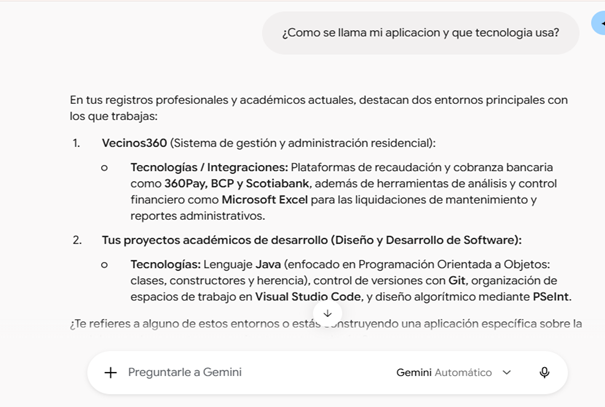

# Bitacora de prompts
 
Laboratorio 06: Fundamentos de Ingenieria de Prompts.
 
Herramienta de IA usada: (Chat GPT)
 
## Ejercicio 2: Tokens y ventana de contexto

| Texto | Caracteres | Tokens |
|-------|------------|--------|
| Los estudiantes programan en Java. | 34 | 7 |
| The students program in Java. | 29 | 6 |
| desafortunadamente | 18 | 4 |

**Captura del resultado cuando se brinda contexto a la IA**

**Captura del resultado cuando no se brinda contexto a la IA**

 
## Ejercicio 3: Temperatura
| Temperatura | % de BiblioTec | Nombres en los 5 intentos |
|-------------|----------------|---------------------------|
| 0 | 100.0%| BiblioTec, LibroYa, PrestaLibro, LectoGo, PaginaLibre, NubeDeTinta|
| 0.5 | 65.3% |BiblioTec, LibroYa, PrestaLibro, LectoGo, PaginaLibre, NubeDeTinta|
| 1 | 44.5% |BiblioTec, LibroYa, PrestaLibro, LectoGo, PaginaLibre, NubeDeTinta|
| 1.8 | 32.2% |BiblioTec, LibroYa, PrestaLibro, LectoGo, PaginaLibre, NubeDeTinta|

Los nombre se mantiene, ya que son los nombre que encuentra en la lista, solo cambia la probabilidad de elección.
 
## Ejercicio 4: Prompt vago vs estructurado
| Criterio | Prompt vago | Prompt estructurado |
|----------|-------------|---------------------|
| Menciona el objetivo del sistema | si | si |
| Menciona a los usuarios principales | no | si |
| Tiene exactamente 3 funcionalidades | no | si |
| Esta en 3 parrafos | no | si |
| Lo usaria en un informe real | no | si |

 
## Ejercicio 5: Anatomia de un prompt
| Componente | Texto de mi prompt |
|------------|--------------------|
| Rol | Desarrollador Java Senior |
| Instruccion | Crea un programa en Java |
| Contexto | Gestión de productos en una tienda virtual |
| Ejemplo | Utiliza una clase Product con los atributos: código, nombre, precio y stock |
| Formato | Métodos: getPrice() y setPrice(double price) |

**Nivel 1:** Me consulta que debe hacer el programa que creará.
**Nivel 2:** Me consulta ¿Qué programa deseas crear?, ¿Qué nivel de complejidad necesitas? y ¿Qué características debe tener?
**Nivel 3:** Crea un programa con 9 funcionalidades y según su criterio.
**Nivel 4:** Crea un programa usando las clases indicadas y atributos indicados en el prompt.
**Nivel 5:** Explica la estructura del programa y crea un programa usando las clases indicadas y atributos indicados en el prompt. 